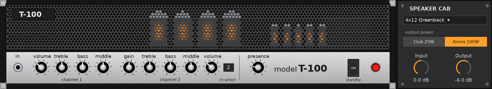

# T-100: Sunn Model T amp for Ableton Live

A Max for Live audio effect modelled from the Sunn Model T (1997 Fender reissue) service schematics: the preamp (sheet 1) and the power amp and output stage (sheet 2). It also has a speaker cab section.



**Install:** drop `T-100 Amp.amxd` onto an audio track in Live (needs Live Suite or Max for Live). It's mono in and dual-mono out.

## Front panel (same layout as the amp)

| Control | Circuit |
|---|---|
| in | V1A 12AX7 input stage (68k grid stopper) |
| Ch 1 volume / treble / bass / middle | R6 1M 10A volume with bright cap → V2A → V2B cathode follower → TMB stack (470p, 68k, .022, .022; 250k / 1M / 25k) |
| Ch 2 gain / treble / bass / middle / volume | R17 + R18 250k gain → V1B → R23/C13 → V3A (18k unbypassed cold clipper) → R28/C15 → V3B → V4A cathode follower → TMB stack (470p, 33k, .022, .022; 250k / 250k / 25k) → R39 + R40 volume |
| ch select | K1/K2 channel relays |
| presence | R110 25k with C43 in the negative feedback loop |
| standby | mutes the output. The jewel light follows it |

Knobs read 1–10 like the real amp, where 5½ is half rotation. Pot tapers follow the schematic codes (10A / 15A / 30A audio, B linear).

## Speaker cab strip

- **Speaker cab**: Direct (no speaker, amp into a resistive load), 4x12 Greenback (Marshall-style), 4x12 V30 (Orange-style), 1x15 Bass (Ampeg-style), 2x12 V30 (Orange-style), 2x10, 1x12 Open, 1x8.
- **Output power**: Club 25W / Arena 100W, the amp's B+ / bias switch (245V / −24V vs 489V / −60V).
- **Input / Output** trims.

## How it's modelled

- **12AX7 stages**: Koren triode equations solved on each stage's load line at device load, using the B+, plate, cathode and AC-load values from the schematic. Includes grid conduction through the source resistance. The 18k cathode on V3A is solved dynamically.
- **Cathode bypass caps** (C11, C7, C17) are modelled as shelving filters. Coupling caps and the R23/C13 and R28/C15 treble-pass dividers come from the part values.
- **Tone stacks**: exact 3rd-order transfer functions from nodal analysis of each stack (`src/tonestack.py`), with source and load impedances, then bilinear-transformed.
- **Power amp**: V6 long-tail phase inverter → 4×6L6GC push-pull class AB → output transformer, with global negative feedback, presence, and supply sag. The non-linear sections run at 2× oversampling.
- **Calibration**: Ch1 and Ch2 levels are checked against the schematic's AC test points (TP1–TP17 at the service settings). Open-loop and closed-loop power-amp gain are checked against TP26/TP27 and the 5% THD output test.

**Approximations:** the Ch1 bright/volume network and the FX loop (treated as unity, which is what the factory loop trims are set for) are simplified. The cabs are EQ-curve models fitted to typical close-mic responses for each speaker type, not measured impulse responses.

## Rebuilding

```
pip install sympy numpy scipy
python3 src/fitcab.py            # (optional) refit cab curves -> src/cabs.json
python3 src/build_amxd.py "T-100 Amp.amxd"
```

`src/t100.genexpr` is the generated gen~ code. To test it offline, compile it as C (`tests/to_c.py`) and run the checks in `tests/` (`run.py`, `t2.py`, `t3.py`).
